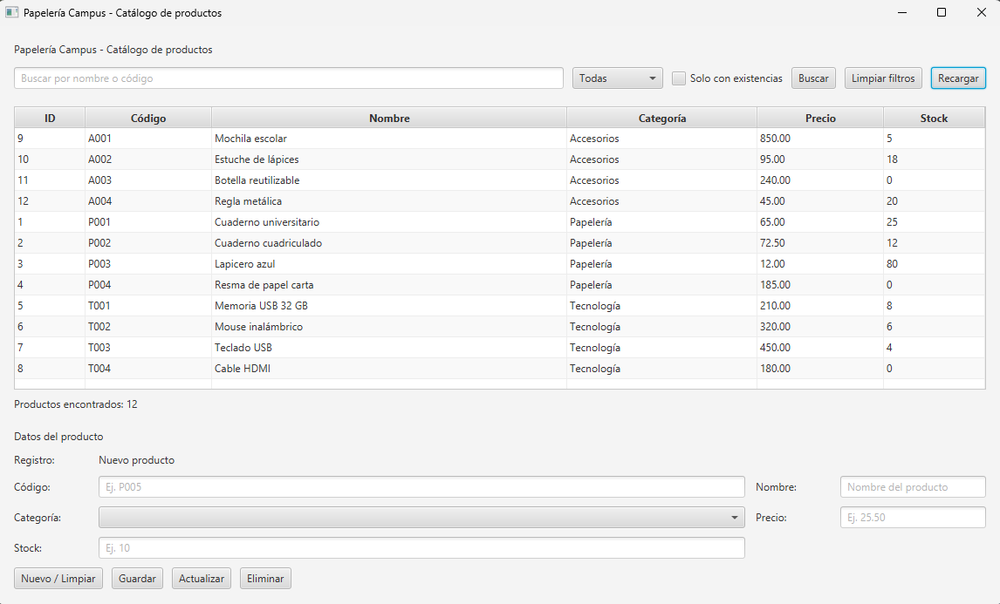

# Papelería Campus

**Autor:** Andrés Eduardo Centeno Zavala
**Fecha de entrega:** 15 de octubre de 2026

## ¿De qué trata mi proyecto?

Hice una aplicación de escritorio para administrar los productos de una papelería de campus. Con ella se puede ver el catálogo completo, buscar productos, y también agregar, modificar o eliminar productos. Los datos se guardan en una base de datos **PostgreSQL**, así que no se pierden al cerrar el programa.

La hice con **Java y JavaFX** para la interfaz gráfica.



## ¿Qué puede hacer la aplicación?

- **Ver todos los productos** en una tabla, ordenados por código.
- **Buscar** escribiendo el nombre o el código del producto. No importa si escribo en mayúsculas o minúsculas.
- **Filtrar** por categoría (Papelería, Tecnología o Accesorios) y mostrar solo los productos que tienen existencias.
- **Registrar** un producto nuevo con el botón *Guardar*.
- **Actualizar** un producto: lo selecciono en la tabla, sus datos aparecen en el formulario, los cambio y pulso *Actualizar*.
- **Eliminar** un producto. Antes de borrarlo, el programa me pide confirmación para evitar borrar algo por error.
- **Validar los datos** antes de guardar, para que no entren datos incorrectos a la base de datos.

## ¿Cómo está organizado el código?

Separé el programa en partes, cada una con una tarea, para que el código esté más ordenado y sea más fácil de entender y de modificar:

| Parte | Archivo | Qué hace |
|---|---|---|
| **Modelo** | `model/Producto.java` | Representa un producto (id, código, nombre, categoría, precio y stock). |
| **Acceso a datos (DAO)** | `dao/ProductoDAO.java` | Es la única clase que escribe las consultas SQL: buscar, insertar, actualizar, eliminar y comprobar si un código ya existe. |
| **Conexión** | `config/DatabaseConfig.java` | Guarda los datos de conexión a PostgreSQL. |
| **Controlador** | `controller/ProductoController.java` | Maneja los botones de la ventana, hace las validaciones y le pide al DAO que trabaje con la base de datos. |
| **Vista** | `vista/producto-view.fxml` y `estilos.css` | Es el diseño de la ventana y sus estilos. |
| **Inicio** | `Main.java` | Es la clase que arranca la aplicación. |

Esta forma de dividir el código se parece al patrón **MVC** con **DAO**. La ventana no habla directamente con la base de datos: primero pasa por el controlador y luego por el DAO.

Todas las consultas usan `PreparedStatement` con parámetros (`?`) en vez de pegar el texto directamente en el SQL. Así evito errores y el problema de seguridad llamado *inyección SQL*.


## Tecnologías usadas

- Java JDK 21
- JavaFX 21
- Maven (el proyecto incluye `mvnw`, así que no hace falta instalarlo aparte)
- PostgreSQL con el driver JDBC 42.7.5
- IntelliJ IDEA

## Cómo ejecutar el proyecto

**1. Clonar el repositorio**

```bash
git clone https://github.com/Kayro232/corte2.git
cd corte2/Evaluacion_Papeleria_Campus-main
```

**2. Crear la base de datos en PostgreSQL**

```sql
CREATE DATABASE papeleria_campus;

-- Después de conectarse a papeleria_campus:
CREATE TABLE producto (
    id_producto SERIAL PRIMARY KEY,
    codigo      VARCHAR(10)   NOT NULL UNIQUE,
    nombre      VARCHAR(80)   NOT NULL,
    categoria   VARCHAR(30)   NOT NULL,
    precio      NUMERIC(10,2) NOT NULL CHECK (precio > 0),
    stock       INTEGER       NOT NULL CHECK (stock >= 0)
);

-- Datos de ejemplo
INSERT INTO producto (codigo, nombre, categoria, precio, stock) VALUES
('P001', 'Cuaderno universitario', 'Papelería',  65.00, 25),
('P002', 'Cuaderno cuadriculado',  'Papelería',  72.50, 12),
('P003', 'Lapicero azul',          'Papelería',  12.00, 80),
('P004', 'Resma de papel carta',   'Papelería', 185.00,  0),
('T001', 'Memoria USB 32 GB',      'Tecnología',210.00,  8),
('T002', 'Mouse inalámbrico',      'Tecnología',320.00,  6),
('T003', 'Teclado USB',            'Tecnología',450.00,  4),
('T004', 'Cable HDMI',             'Tecnología',180.00,  0),
('A001', 'Mochila escolar',        'Accesorios',850.00,  5),
('A002', 'Estuche de lápices',     'Accesorios', 95.00, 18),
('A003', 'Botella reutilizable',   'Accesorios',240.00,  0),
('A004', 'Regla metálica',         'Accesorios', 45.00, 20);
```

**3. Poner mis datos de conexión**

En el archivo `config/DatabaseConfig.java` hay que cambiar el usuario y la contraseña por los de PostgreSQL de cada computadora:

```java
private static final String URL = "jdbc:postgresql://localhost:5432/papeleria_campus";
private static final String USUARIO = "postgres";
private static final String CLAVE = "tu_contraseña";
```

**4. Ejecutar**

- En IntelliJ IDEA: recargar las dependencias de Maven y ejecutar la clase `edu.uam.ni.evaluacion.Main`.
- O desde la terminal: `./mvnw javafx:run` (en Windows: `mvnw.cmd javafx:run`).

## Pruebas que hice

Guardé capturas de cada prueba en la carpeta `evidencias/`:

| Prueba | Captura |
|---|---|
| Buscar productos | [Busqueda.png](Evaluacion_Papeleria_Campus-main/evidencias/Busqueda.png) |
| Registrar un producto | [Guardar.png](Evaluacion_Papeleria_Campus-main/evidencias/Guardar.png) |
| Actualizar un producto | [Actualizar.png](Evaluacion_Papeleria_Campus-main/evidencias/Actualizar.png) |
| Eliminar un producto | [Eliminar.png](Evaluacion_Papeleria_Campus-main/evidencias/Eliminar.png) |

También comprobé que el programa rechaza los campos vacíos, un precio o stock inválido y los códigos repetidos, y que al cancelar la eliminación el producto no se borra.

## Estructura de carpetas

```
Evaluacion_Papeleria_Campus-main/
├── pom.xml
├── evidencias/                 (capturas de las pruebas)
└── src/main/
    ├── java/edu/uam/ni/evaluacion/
    │   ├── Main.java
    │   ├── config/DatabaseConfig.java
    │   ├── model/Producto.java
    │   ├── dao/ProductoDAO.java
    │   └── controller/ProductoController.java
    └── resources/edu/uam/ni/evaluacion/vista/
        ├── producto-view.fxml
        └── estilos.css
```
